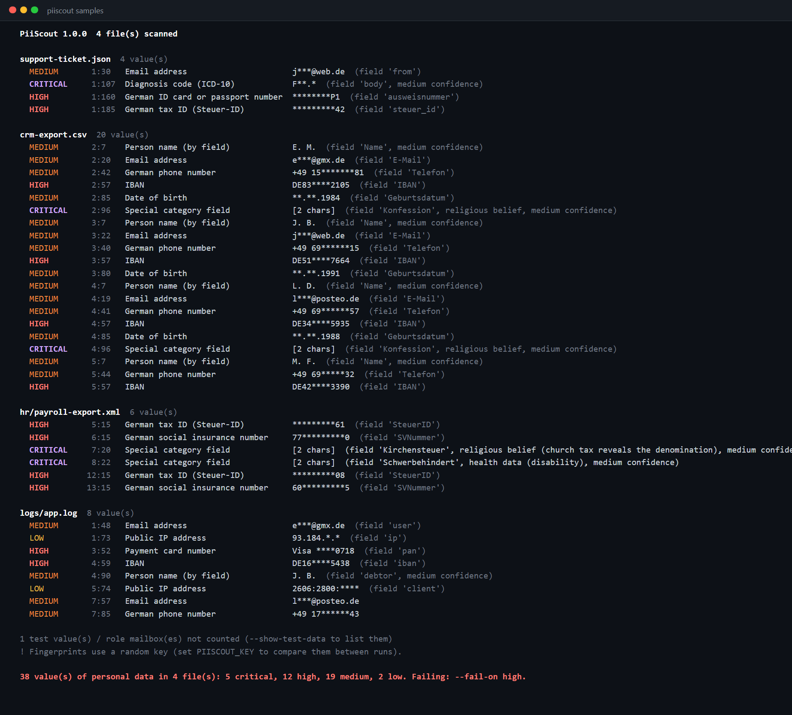

# PiiScout

**Finds personal data (GDPR / DSGVO) in files, logs, exports and test fixtures. Every hit is validated (check digits,
issuer prefixes, date and range rules), understood in its column or field, and reported only in masked form.
It writes a data map, SARIF for GitHub Code Scanning, and redacted copies of files you need to share.**



> 🇩🇪 **Kurzbeschreibung:** PiiScout findet personenbezogene Daten in Dateien, Logs und Exporten: E-Mail-Adressen, Telefonnummern,
> IBANs, Kreditkartennummern, Steuer-IDs, Personalausweis- und Sozialversicherungsnummern, IP-Adressen und besondere Kategorien nach
> Art. 9 DSGVO (Gesundheit, Religion inkl. Kirchensteuermerkmal, Gewerkschaft). Jeder Treffer wird über Prüfziffern validiert und nur
> maskiert ausgegeben. Die Datenkarte hilft beim Verzeichnis von Verarbeitungstätigkeiten (Art. 30), `redact` entfernt Daten vor der
> Weitergabe eines Logs (Datenminimierung, Art. 5), und in CI bricht der Build ab, wenn echte Kundendaten im Repository landen.

---

## Why

Personal data ends up where nobody planned it: a production CSV copied into `tests/`, card numbers in an application log
because someone logged the whole request, a sick note with a diagnosis attached to a helpdesk ticket, a payroll export on a shared drive.
Under the GDPR every one of those copies needs a legal basis, access control and a deletion date, and a company first has to
**know where they are**, for its records of processing (Art. 30), for a data subject's access or erasure request (Art. 15, 17) and
for the 72-hour breach notification (Art. 33).

Regex-only scanners drown that question in false positives: every 11-digit order number looks like a tax ID. PiiScout:

- **Validates instead of guessing.** IBAN mod 97 with per-country length, Luhn plus card network prefix, the ISO 7064 check digit and
  digit rule of the Steuer-ID, the ICAO 7-3-1 check digit of the Personalausweis, the check digit and birth date inside the
  Sozialversicherungsnummer, public vs. private IP ranges.
- **Reads structure.** CSV headers (comma, semicolon from German Excel, tab, pipe), JSON properties, `key=value` log fields and XML
  elements become context: a valid 11-digit tax ID alone is a weak hit, the same number in a column `SteuerID` is a strong one.
- **Knows German specifics.** Steuer-ID, Personalausweis, Rentenversicherungsnummer, German phone formats, and the
  **Kirchensteuermerkmal** in payroll data, which reveals a person's religion and is therefore Art. 9 data.
- **Never prints a value.** Reports show `DE89****3000`, `Visa ****1111`, `e***@gmx.de`. Distinct values are counted with
  keyed HMAC-SHA256 fingerprints, so a report can say "4 IBANs, 4 different people" without containing any of them.
- **Separates test data from real data.** Published test cards (4111 1111 1111 1111), example IBANs, `example.com`, documentation IP
  ranges and the Mustermann specimen ID card are information only; role mailboxes (`datenschutz@`, `support@`) are not people.

## Quick start

```bash
git clone https://github.com/karicamar/piiscout && cd piiscout
dotnet run --project src/PiiScout.Cli -- samples               # synthetic data, see samples/README.md
dotnet run --project src/PiiScout.Cli -- path/to/folder --format markdown -o report.md
dotnet run --project src/PiiScout.Cli -- redact samples/logs/app.log --pseudonymize
```

Or install it as a .NET tool: `dotnet pack src/PiiScout.Cli -c Release -o nupkg && dotnet tool install -g PiiScout --add-source nupkg`, then `piiscout`.

```text
Usage:
  piiscout [scan] [folder | file] [options]       Scan and report (values are always masked)
  piiscout redact <file> [-o out | --in-place]    Write a copy with personal data masked
  piiscout detectors                              List what PiiScout detects

Scan options:
  -f, --format <console|json|markdown|sarif>     Output format (default: console)
  -o, --output <file>                            Write the report to a file
      --fail-on <critical|high|medium|low|none>  Exit code 1 at this severity or above (default: high)
      --min-confidence <low|medium|high>         Report hits from this confidence (default: medium)
      --ignore-file <file>                       Accepted findings (default: .piiscout-ignore in the folder)
      --exclude <name or path>                   Skip a file or folder (repeatable)
      --max-file-size <MB>                       Skip larger files (default: 25)
      --show-test-data                           Also list test values and role mailboxes

Redact options:
      --pseudonymize                             Stable tokens like [IBAN:3f2a91c0...] instead of masks
      --include-test-data                        Also replace published test values

Environment:
  PIISCOUT_KEY    Secret for fingerprints and pseudonyms, so they stay the same between runs

Exit codes: 0 = OK, 1 = findings at or above --fail-on, 2 = error.
```

## What it detects

| Id | Data | Validation | Severity |
|---|---|---|---|
| `PII-ART9-FIELD` | Filled fields about religion (incl. Kirchensteuer), trade union, ethnic origin, health, disability, sexual orientation, genetic/biometric data | field name, value not empty | critical |
| `PII-HEALTH-ICD` | ICD-10 / ICD-10-GM diagnosis codes | code format **and** a word like Diagnose, ICD, Befund, Krankschreibung | critical |
| `PII-IBAN` | IBAN, compact or in groups of four | country length (ISO 13616) + mod 97 | high |
| `PII-CARD` | Card numbers of Visa, Mastercard, Amex, Discover, JCB, Diners, Maestro | Luhn + issuer prefix + length | high |
| `PII-DE-TAXID` | Steuerliche Identifikationsnummer | digit rule + ISO 7064 MOD 11,10 | high |
| `PII-DE-IDCARD` | Personalausweis / Reisepass number | reduced alphabet + ICAO 7-3-1 | high |
| `PII-DE-SVNR` | Rentenversicherungsnummer | birth date, letter, check digit | high |
| `PII-EMAIL` | Email addresses | role mailboxes and reserved domains are info | medium |
| `PII-PHONE` | German phone numbers (+49, 0049, national) | number length, mobile prefixes, context | medium |
| `PII-DOB` | Dates of birth | real date, not in the future, **and** geb./Geburtsdatum/dob | medium |
| `PII-NAME-FIELD` | Person names | only in fields like Nachname, Kontoinhaber, debtor, or a CSV column "Name" | medium |
| `PII-IP` | Public IPv4 / IPv6 addresses (CJEU C-582/14, Breyer) | private, loopback, CGNAT, link-local skipped; networks (/24) and four-part versions ignored | low |

**Confidence.** Check digits catch random strings, but some numbers pass by chance: one in ten random 10-character codes has a
"valid" ID card check digit. So a detector reports *high* confidence with a context word or matching field name, *medium* for
strong formats (grouped card number, international phone number), and *low* otherwise. Scans show medium and above by default,
`redact` replaces everything down to low, because when you share a file it is better to mask one order number too many.

## Data map

The Markdown and JSON reports aggregate per file, field and data type, with the number of values and of distinct values
([full example](docs/example-report.md)):

| Severity | File | Field | Data | Values | Distinct |
|---|---|---|---|---:|---:|
| 🟣 Critical | `crm-export.csv` | `Konfession` | Special category field | 2 | 2 |
| 🟣 Critical | `hr/payroll-export.xml` | `Kirchensteuer` | Special category field | 1 | 1 |
| 🔴 High | `crm-export.csv` | `IBAN` | IBAN | 4 | 4 |
| 🔴 High | `logs/app.log` | `pan` | Payment card number | 1 | 1 |
| 🟠 Medium | `crm-export.csv` | `E-Mail` | Email address | 3 | 3 |

That is the input a data protection officer needs for the records of processing activities, and the list of places to search when
someone asks "what do you store about me?". A large export is counted in full; the finding list shows the first 25 hits per
detector and file.

## Redaction: share the log, not the customer

Support asks for the log of a failed payment. `piiscout redact` writes a copy with the personal data replaced, keeps the structure
(line endings, CSV columns, valid JSON) and leaves everything else as it was ([example](docs/app.redacted.log)):

```text
WARN  pay   card declined pan=Visa ****0718 amount=49.90 EUR order=88213
ERROR pay   SEPA mandate failed iban=DE16****5438 debtor="J. B."
INFO  build version 10.0.400.12 deployed from 192.168.1.20
```

With `--pseudonymize` every value becomes a keyed token: the same customer gets the same token in every line and file, so the log can
still be analyzed ("this IBAN failed three times") without revealing who it is ([example](docs/crm-export.pseudonymized.csv)).
With the same `PIISCOUT_KEY` the tokens are stable across files and days; without a key they are random per run.
Pseudonymized data is still personal data under the GDPR (Recital 26), but the risk is much lower; masks are closer to anonymous.

The test suite checks that every redacted sample scans clean afterwards, down to low confidence.

## In CI

```yaml
- name: No personal data in the repository
  run: dotnet tool run piiscout . --fail-on high --format sarif -o piiscout.sarif
- uses: github/codeql-action/upload-sarif@v4
  if: always()
  with:
    sarif_file: piiscout.sarif
```

SARIF results carry the masked value and a `partialFingerprints` entry with the keyed fingerprint, so Code Scanning tracks the same
value across commits without ever seeing it ([example](docs/example.sarif)). Paths are repository-relative (Code Scanning rejects
absolute URIs). Inside GitHub Actions the Markdown data map is also written to the run's summary page.

Data that belongs in the repository goes into `.piiscout-ignore`. Every entry needs a reason; an expired entry counts again:

```text
# path glob            detector     reason                                         expiry (optional)
tests/Fixtures/**      *            reason="synthetic customers, generated"       expires=2027-06-30
docs/impressum.md      PII-PHONE    reason="published company number (§ 5 DDG)"
```

This repository dogfoods it: the [CI workflow](.github/workflows/ci.yml) scans the whole repo (the synthetic samples and test values
are accepted in [.piiscout-ignore](.piiscout-ignore)), and a second job redacts the sample log and checks that the copy is clean.
Running it across my other projects found real false-positive patterns, now fixed and covered by tests: Razor markup
(`item-@i.Id`) that looked like an email, four-part version numbers that looked like IP addresses, CIDR ranges in comments,
and the detectors' own example values in their descriptions.

## Design notes

- **No value leaves the scanner.** A `Detection` (with the raw value) lives only inside one line's scan; a `Finding` has the masked form
  and the fingerprint. The tests check that none of the raw sample values appears in the JSON, Markdown or SARIF output.
- **Overlaps.** The digits of an IBAN can also look like a phone number or tax ID. Per line, the more severe, then the longer hit wins.
  An Art. 9 field is about the column, so hits inside it (a diagnosis code in a `diagnose` field) stay visible.
- **Encodings.** UTF-8 with and without BOM, UTF-16 with BOM, and a Windows-1252/Latin-1 fallback for German Excel exports
  (`Jürgen Weiß` in a semicolon CSV). Binary files are recognized by extension and NUL bytes and skipped, like `bin/`, `obj/`, `.git/`, `node_modules/`.
- **Fingerprints** are HMAC-SHA256 over the detector id and the normalized value (`DE89 3704…` and `DE893704…`, `+49 69…` and `069…` are the same).
  With a secret key a fingerprint cannot be reversed by trying all IBANs or phone numbers, which a plain hash could.

## Limitations

- Names, addresses and free-text descriptions of people are only found through field names, not in prose. That needs NLP
  (named entity recognition) and is out of scope for a fast, deterministic CI check.
- Internal IP addresses can be personal data inside a company network too; PiiScout skips them to stay quiet in logs.
- The German identifiers are covered in depth; for other countries only IBAN, cards, email, IP and the Art. 9 fields apply.
- Office documents, PDFs and archives are not opened (export them to text or CSV first).

## Project layout

```text
src/PiiScout.Core/
  Detectors/   Checksums (IBAN, Luhn, Steuer-ID, ID card, SV number), 12 detectors, line context
  Scanning/    folder walk and decoding, CSV/JSON/XML field extraction, overlap resolution, fingerprints, redaction
  Policy/      .piiscout-ignore (globs, reasons, expiry)
  Reporting/   JSON, Markdown data map, SARIF 2.1.0
src/PiiScout.Cli/     the piiscout command (scan, redact, detectors)
tests/PiiScout.Tests/ 224 xUnit tests
samples/              synthetic CRM export, application log, helpdesk ticket, payroll XML, test fixtures
```

```bash
dotnet test
```

## License

MIT
